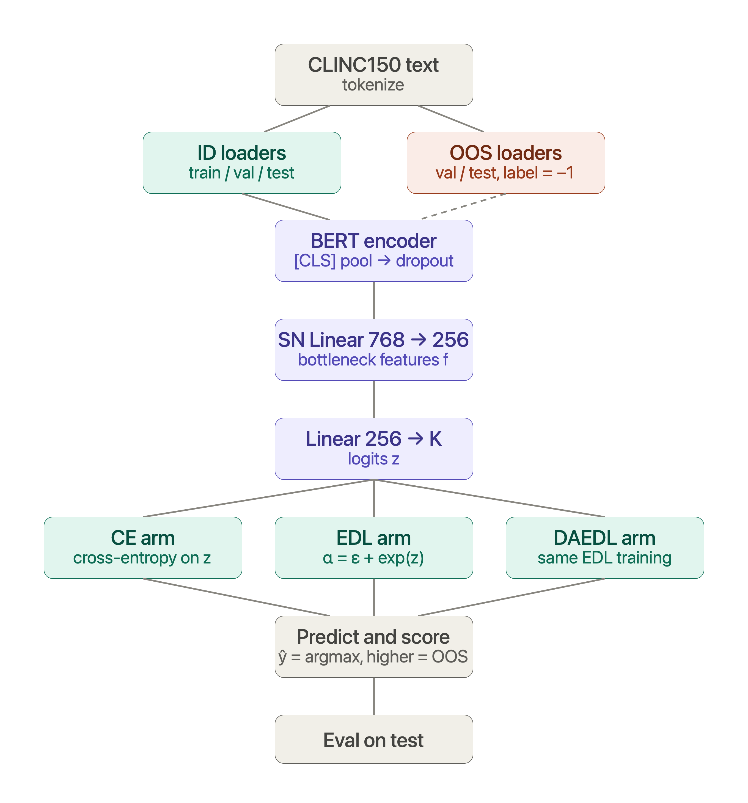
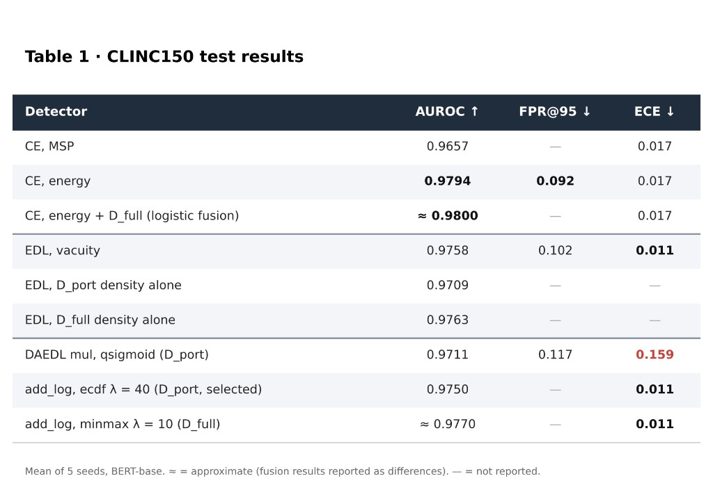
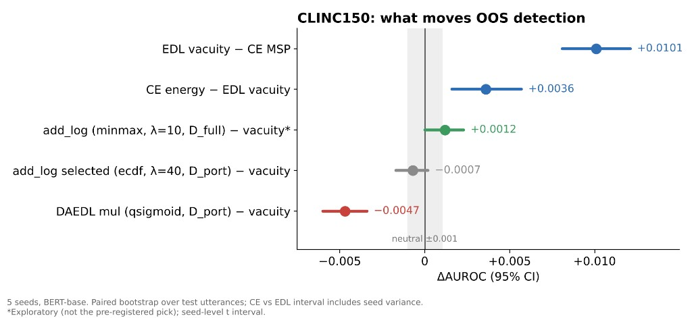
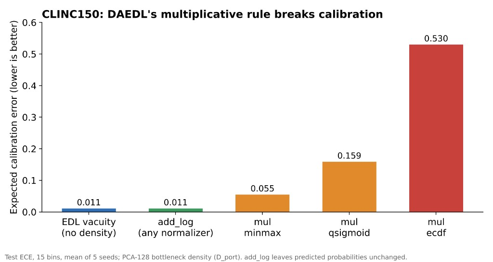
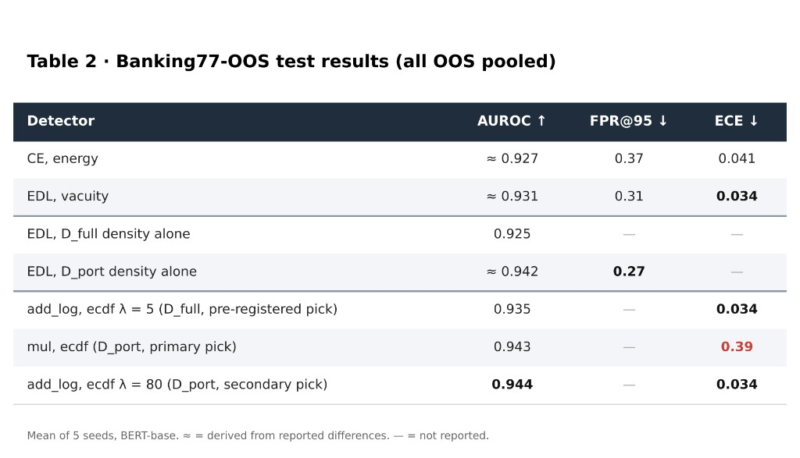
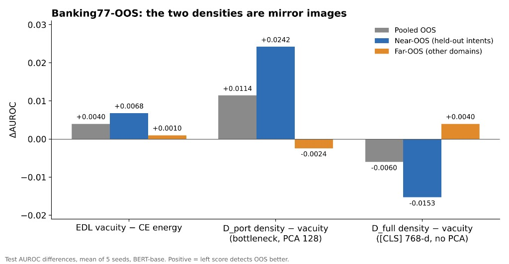
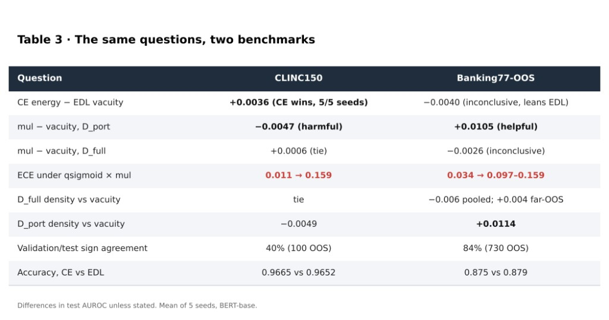

# Epistemic Ranker — Evidential BERT on CLINC150 and Banking77-OOS

Milestone 1: leak-free CLINC150 pipeline and three experiment arms
(**CE**, **vanilla EDL**, **DAEDL-style density-scaled EDL**) with diagnostics
that catch an inert density term. A pre-registered Banking77-OOS replication
(BERT-base, same head and recipe) is recorded below.

See [`bert_edl_clinc150_implementation_plan.md`](bert_edl_clinc150_implementation_plan.md)
for the full design. Early-exit heads are deferred to Milestone 2.

## Overview architecture

Shared BERT encoder, spectrally-normalized bottleneck, then three arms
(**CE**, **EDL**, **DAEDL**) on the same features and logits:



CLINC150 text is tokenized and passed through BERT (`[CLS]` + dropout), an
SN linear bottleneck \(768\to256\) producing features \(\mathbf{f}\), and a
linear head \(256\to K\) producing logits \(\mathbf{z}\). ID loaders drive
training; OOS loaders (label = \(-1\)) are used only at val/test. The arms
then diverge:

- **CE** trains with cross-entropy on \(\mathbf{z}\)
- **EDL** maps logits to Dirichlet evidence \(\alpha = \varepsilon + \exp(z)\)
- **DAEDL** reuses the EDL weights and scales evidence by a GDA density
  \(\hat{p}(\mathbf{f})\) at inference

Prediction is \(\hat{y} = \arg\max\); OOS scores use a single convention
(higher = more OOS).

## The bug story, and what we found

Density-aware evidential models (DAEDL) scale Dirichlet evidence by a
feature-space density \(\hat{p}(x)\). On our CIFAR replication, that term
could look healthy in the code path while doing almost nothing: min-max
normalization squashed ID log-densities into a tiny band near 1, so
\(\exp(z \odot \hat{p}) \approx \exp(z)\). AUROC still looked fine because
it was vanilla EDL wearing a costume. We call that failure mode **INERT**.

This repo treats that as a first-class bug class. Every DAEDL run writes
`diagnostics.json` with a **materiality gate** (rank correlation of
\(\alpha_0\), relative \(\Delta\alpha_0\), prediction flip-rate). Configs
marked `density_effect: INERT` are disqualified even if AUROC looks good.
We also redesign normalization for NLP (`qsigmoid` / `ecdf`, not only
min-max), default to tied-covariance GDA with PCA+whitening on BERT
features, and keep a single score convention: **higher = more OOS**.

### Milestone 1 results (CLINC150-plus, 5 seeds)

BERT-base, SN bottleneck \(768\to256\), 5 epochs. Mean of five seeds.
Table 1 groups the detectors into CE scores, EDL scores and densities, and
couplings. A dash means that cell was not reported. Entries marked ≈ come
from fusion results that were stored as differences.



CE energy is the strongest logit score (AUROC 0.9794, FPR@95 0.092). EDL
vacuity is close on detection (0.9758) and better calibrated (ECE 0.011
versus 0.017). Logistic fusion of CE energy with the full `[CLS]` density
is about 0.980. The default multiplicative coupling, `qsigmoid` × mul on
the bottleneck density, drops to 0.9711 AUROC and raises ECE to 0.159.
Additive coupling leaves the predictive probabilities unchanged, so its ECE
stays at the vacuity value 0.011. The validation-selected additive rule
(`ecdf`, λ = 40, D_port) does not beat vacuity.

Figure 1 is the same comparison as paired differences. The grey band is the
±0.001 neutral zone. The `add_log` row on D_full is exploratory, which is
why it is marked with an asterisk.



Vacuity beats CE MSP by about +0.010. CE energy beats vacuity by about
+0.0036. Multiplicative `qsigmoid` coupling on D_port loses about 0.0047.
The selected additive coupling on D_port is inside the neutral band.

The asterisked D_full `add_log` interval is a seed-level *t* interval, not
the paired bootstrap used for the other rows, so it is not strictly
comparable. The figure footnote records that. A bootstrap for that one
contrast has not been substituted yet.

Figure 2 is why the multiplicative rule is a diagnosed negative even when
AUROC only moves a little. Test ECE is 0.011 for vacuity and for `add_log`
under every normalizer. `mul` raises it to 0.055 (minmax), 0.159
(qsigmoid), and 0.530 (ecdf).



Materiality on the DAEDL seeds is **ACTIVE**: the density moves
\(\alpha_0\) (median relative change ~0.80). It is not the CIFAR inert
trap. The source tables are `results/summary.csv` and `results/posthoc/`.

**Takeaway:** on CLINC150, EDL vacuity beats CE MSP at almost the same
accuracy, and CE energy is the best simple detector. Multiplicative density
scaling is measurable and it wrecks calibration. Additive scaling keeps
calibration and does not improve detection. The Banking77-OOS replication
below does not carry the energy-over-vacuity ranking.

## Banking77-OOS replication (BERT-base, 5 seeds)

Rules were frozen in [`PREREGISTRATION.md`](PREREGISTRATION.md) at `eb040dd`
(`prereg-replication`) before any test number from this study was computed.
Same encoder, spectral-norm bottleneck, AdamW schedule, and five seeds as
CLINC150. K = 50. No outlier exposure: the 2,062 ID-OOS training utterances
are never loaded. Pooled test OOS is 1,080 same-domain held-out intents
(ID-OOS) plus 1,000 CLINC150 out-of-scope utterances (OOD-OOS), scored
against the same 2,000 in-scope test utterances. Worst truncation at 64
tokens was 0.46%. The ±15 logit clamp binds on 0% of in-scope test rows, so
`energy` and `energy_clip` are the same score. Verdicts use the combined
interval, SE = √(SE²_boot + s²_seed / 5), and are copied from
`results_b77/posthoc/verdicts/verdicts.md`.

In-scope accuracy is 0.875 (CE) versus 0.879 (EDL). It is lower than
CLINC150 because the task is 50 banking intents, not because a seed
collapsed. Every seed is within half a point of its arm mean.

Table 2 is the pooled test set. `D_port` is the 256-d bottleneck with PCA
to 128. `D_full` is the 768-d `[CLS]` vector with no PCA. Values marked ≈
were recovered from reported differences. The bottleneck density alone is
the strongest detector in the table (AUROC about 0.942, FPR@95 0.27).
Vacuity is about 0.931 and better calibrated than CE energy (ECE 0.034
versus 0.041). The pre-registered D_full pick, `ecdf` add_log at λ = 5,
reaches 0.935 while keeping that ECE. Multiplicative `ecdf` on D_port
reaches 0.943 and pushes ECE to 0.39. The secondary D_port pick, `ecdf`
add_log at λ = 80, reaches 0.944 and leaves ECE at 0.034.



Figure 3 splits three comparisons into pooled OOS, near-OOS (held-out
banking intents), and far-OOS (CLINC-sourced, other domains). Positive
means the score on the left detects OOS better. The two densities are
mirror images: the bottleneck density gains on near-OOS (+0.0242) and is
flat to slightly worse on far-OOS (−0.0024), while the full `[CLS]` density
loses on near-OOS (−0.0153) and gains on far-OOS (+0.0040). Vacuity’s edge
over CE energy is small on every slice (+0.0040 pooled, +0.0068 near,
+0.0010 far).



Figure 3 has no error bars. The near-OOS and far-OOS heights are seed
means. Interval estimates for those bars are not in the notes yet, so the
plot shows the sign and the size of the mean difference only.

Held-out banking intents remain the hard slice for the logit scores
themselves: EDL vacuity is 0.8746 ± 0.0033 on ID-OOS and 0.9919 ± 0.0007
on OOD-OOS, against the same 2,000 in-scope test utterances.

Table 3 puts the two benchmarks on the same questions. Multiplicative
coupling on D_port hurts CLINC150 (−0.0047) and helps Banking77 (+0.0105).
ECE under `qsigmoid` × mul jumps from 0.011 to 0.159 on CLINC150 and from
0.034 into the 0.097–0.159 range on Banking77. Validation and test agree on
the sign of the effect in 40% of cells when the validation OOS set has 100
utterances (CLINC150) and in 84% when it has 730 (Banking77).



Pre-registered decisions on pooled Banking77 test OOS, with the combined
interval rather than the rounded cells in Table 3:

| Claim | Verdict | Estimate | Combined 95% CI |
|-------|---------|---------:|-----------------|
| H1: CE energy − EDL vacuity | inconclusive | −0.0040 | [−0.0086, +0.0006] |
| H2: `qsigmoid`×mul − vacuity, D_full | inconclusive | −0.0026 | [−0.0072, +0.0021] |
| H2: `qsigmoid`×mul − vacuity, D_port | refuted | +0.0105 | [+0.0064, +0.0146] |
| H3: extra gain on ID-OOS versus OOD-OOS | inconclusive | +0.0053 | [−0.0005, +0.0111] |
| Positive: D_full primary pick vs vacuity and vs D_full alone | supported | +0.0035 / +0.0096 | [+0.0005, +0.0066] and [+0.0060, +0.0132] |

H1 does not reproduce the CLINC ranking in which energy beat vacuity. The
estimate favors vacuity by 0.4 points and the 95% interval includes zero.
Holm-adjusted one-sided p = 0.96.

H2 asked whether multiplicative coupling stays inside +0.002 AUROC of plain
vacuity and worsens ECE. On D_full the AUROC interval still covers both
sides of zero (coupled ECE is worse on 5/5 seeds). On D_port the AUROC gain
is about +1.1 points with the whole 95% interval above zero, so the
"no benefit" bound is refuted there. ECE is still worse on 5/5 seeds.
The validation rule on D_port picks `ecdf` × mul, test AUROC
0.9429 ± 0.0036, about the same level as the bottleneck density alone.

The positive claim is supported, including after Holm (adjusted p = 0.033).
Both the primary and secondary rules select `ecdf` add_log at λ = 5 on
D_full. That coupling beats vacuity by +0.35 points and the full-vector
density alone by +0.96 points. λ = 5 is interior (runners-up are λ = 10
and λ = 2), so the gain is not reported as a grid-edge lower bound.
Additive coupling of the full `[CLS]` density is a real, small improvement
on this benchmark. The CLINC diagnosed-negative was the default
`qsigmoid` × mul rule, which remains unresolved on D_full here.

H3 uses that same D_full pick. The gain over vacuity is +0.61 points on
ID-OOS and +0.08 points on OOD-OOS (difference +0.53 points). The 95%
interval includes zero, and Holm does not reject (adjusted p = 0.075).
The near-OOS mechanism stays an observation, not a confirmed claim.

RoBERTa-base on CLINC150 is specified in the pre-registration and has not
been run. The RoBERTa × Banking77 cross is only required if that study
disagrees with these H1 or H2 verdicts.

## Layout

```
src/bert_daedl/          # CLINC150 and Banking77-OOS package
PREREGISTRATION.md       # frozen Banking77 / RoBERTa analysis rules (eb040dd)
src/daedl/               # Epic Ranker phase 2/3 library (density-scaled trainer)
src/epic_ranker/         # phase1.py and phase2.py script entry points
src/data/mine.py         # MS MARCO pair mining for Epic Ranker
scripts/run_experiment.py
scripts/aggregate_results.py
scripts/run_daedl.py
configs/default.yaml
tests/
docs/                    # phase checklists and fix notes
archives/                # superseded scripts, including the old CLINC stubs
```

## Setup

```bash
uv venv .venv && uv pip install -r requirements.txt
export PYTHONPATH=src
```

Local CLINC150 JSON is expected at `data/CLINC150/data_full.json`
(fallback when HF `clinc_oos` is unavailable; `datasets>=3` drops script support).
Banking77-OOS lives at `data/BANKING77-OOS` (jianguoz/Few-Shot-Intent-Detection,
commit `fa95533`). `make b77-check` refuses to train if a split count drifts
or more than 2% of a split is truncated at 64 tokens.

## Quick commands

```bash
make test                          # unit tests (excludes slow smoke)
make ce SEED=0                     # CE baseline
make edl SEED=0
make daedl SEED=0 NORM=qsigmoid MODE=mul
make seeds ARM=ce                  # seeds 0..4
make aggregate

make b77-check DEVICE=mps          # Banking77 sizes and truncation
make b77-train DEVICE=mps          # CE and EDL, seeds 0–4, caches in results_b77/
make b77-posthoc                   # densities, λ grid, bootstrap, verdicts

python -m src.data.mine            # Epic Ranker MS MARCO pairs
python -m src.epic_ranker.phase1   # AG News evidential baseline
python -m src.epic_ranker.phase2   # MS MARCO pointwise evidential ranker
python scripts/run_daedl.py        # phase 2/3 trainer with density scaling
```

Or:

```bash
PYTHONPATH=src python scripts/run_experiment.py --arm ce --seed 0 --device mps
```

## Arms

| Arm | Train loss | Scores |
|-----|------------|--------|
| `ce` | cross-entropy | msp, entropy, energy, neg_logp |
| `edl` | EDL (EXP + KL anneal) | + vacuity, pred_entropy, mutual_info, … |
| `daedl` | same weights as `edl` (post-hoc) | + `daedl_*` density-scaled scores |

Selection uses `id_val` + `oos_val` only; test is touched once per chosen config.
Every run writes `results/<arm>_seed<N>/results.json` and `diagnostics.json`
(`density_effect: ACTIVE|INERT`).
